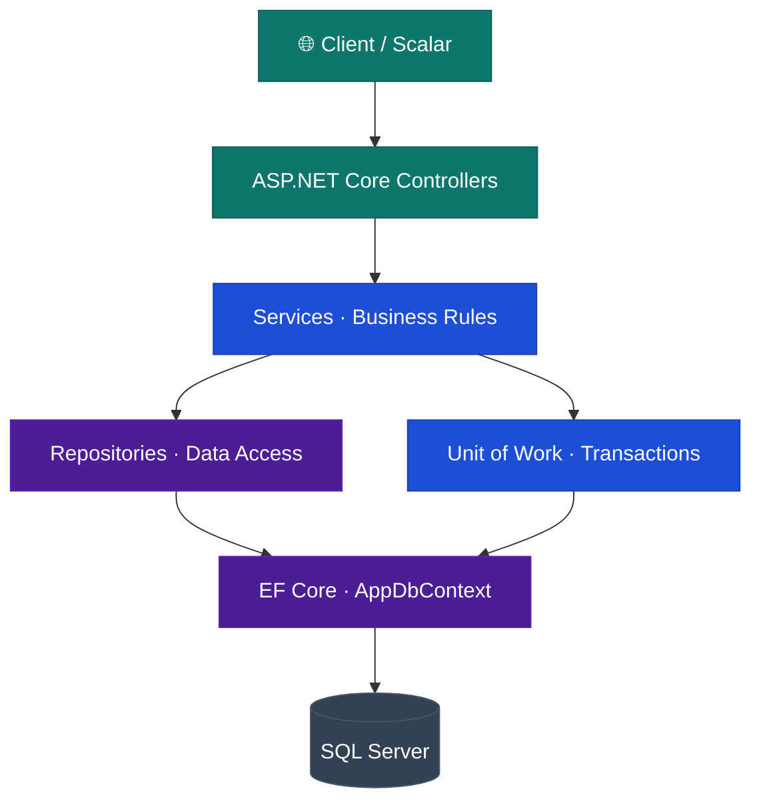
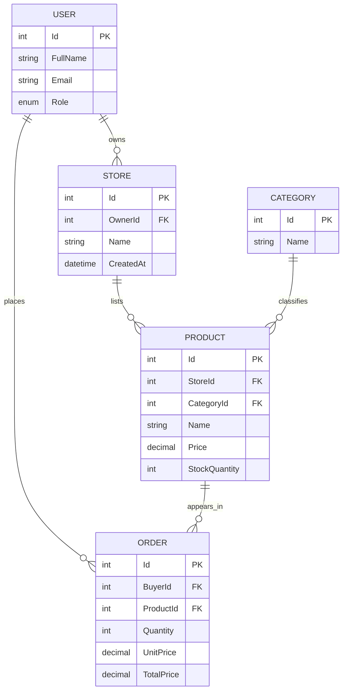
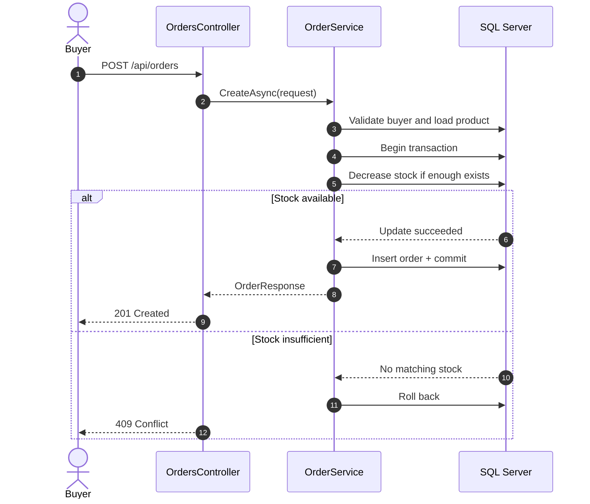
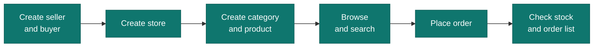

[MarketPlaceAPI.md](https://github.com/user-attachments/files/34842529/MarketPlaceAPI.md)
<div align="center">

# 🛍️ MarketPlace API

**A clean, layered marketplace backend built with ASP.NET Core.**


<br />

[](https://dotnet.microsoft.com/)
[](https://learn.microsoft.com/dotnet/csharp/)
[](https://www.microsoft.com/sql-server)
[](https://www.docker.com/)
[](https://scalar.com/)

<br />

[Overview](#-overview) • [Architecture](#-architecture) • [Data Model](#-data-model) • [Quick Start](#-quick-start) • [API Reference](#-api-reference) • [Testing](#-testing)

</div>

---

## ✨ Overview

**MarketPlace API** is a small online marketplace where sellers create stores and publish products, while buyers browse, search, and place orders. It demonstrates practical separation of concerns with **Repository Pattern**, **Service Pattern**, **EF Core**, and RESTful controllers.

| 🏬 Seller experience | 🔎 Buyer experience | 📦 Order integrity |
| :--- | :--- | :--- |
| Create a store | Browse all stores | Validate buyer and product |
| Publish categorized products | Search by name | Check available inventory |
| Manage starting price and stock | Filter by category and price | Decrease stock atomically |
| Store ownership validation | Paginated product listings | Review personal order history |

> [!NOTE]
> This project is an educational API. Its user IDs are provided by clients; **authentication and trustworthy authorization are not implemented**. Do not deploy it as a public marketplace without those safeguards.

## 🧱 Architecture

The HTTP layer is intentionally thin. Controllers handle requests, services enforce domain rules, repositories handle persistence, and EF Core talks to SQL Server.



<details>
<summary><strong>📁 Explore the project structure</strong></summary>

```text
MarketPlace/
├── MarketPlace.sln
├── MarketPlace.Api/
│   ├── Controllers/           HTTP endpoints
│   ├── DTOs/                  Request / response contracts
│   ├── Entities/              Domain entities
│   ├── Services/              Business logic + interfaces
│   ├── Repositories/          EF Core queries + interfaces
│   ├── Data/                  AppDbContext and UnitOfWork
│   ├── Migrations/            Initial database schema
│   ├── Exceptions/            Centralized API errors
│   ├── Program.cs             Dependencies and middleware
│   └── MarketPlace.Api.http   Sample API requests
├── scripts/smoke_test.py      End-to-end scenario
├── Dockerfile
├── docker-compose.yml
└── README.md
```

</details>

## 🗄️ Data Model

Five core entities and their relationships are configured with Entity Framework Core.



A single order contains **one product and a quantity** (the assignment's scope). The price is copied into the order at purchase time so historical totals are not affected by future product-price changes.

## 🔄 Order Lifecycle

The stock decrease and order insertion take place in **one database transaction**. A conditional update ensures two concurrent buyers cannot both consume the same remaining inventory.



## 🚀 Quick Start

### Option A — Docker (recommended)

Requires Docker Desktop / Docker Engine with Compose.

**Windows Command Prompt** (from the project root):

```bat
copy .env.example .env
docker compose up --build
```

**PowerShell:**

```powershell
Copy-Item .env.example .env
docker compose up --build
```

**macOS / Linux:**

```bash
cp .env.example .env
docker compose up --build
```

| Service | Local URL |
| :--- | :--- |
| 🧪 Scalar API reference | **http://localhost:8080/scalar** |
| 💚 Health check | http://localhost:8080/health |
| 🌐 API base | http://localhost:8080 |
| 🗃️ SQL Server | `localhost:14333` |

The development API applies the included `InitialCreate` migration at startup. SQL Server may need a short initialization period; the API retries temporary connection failures.

### Option B — Run with the .NET SDK

Requires .NET 10 SDK and a reachable SQL Server instance.

```bash
docker compose up -d sqlserver
dotnet tool restore
dotnet restore MarketPlace.sln
dotnet ef database update --project MarketPlace.Api
dotnet run --project MarketPlace.Api --launch-profile http
```

**Scalar:** http://localhost:5080/scalar  
**OpenAPI document:** http://localhost:5080/openapi/v1.json

The local connection string lives in `MarketPlace.Api/appsettings.json`. Override `ConnectionStrings__DefaultConnection` for a different database. Development credentials in this repository are examples only; use a unique password outside a disposable local environment.

## 🧩 API Reference

<details open>
<summary><strong>Users & Stores</strong></summary>

| Method | Endpoint | Purpose |
| :---: | :--- | :--- |
| `POST` | `/api/users` | Register a buyer or seller |
| `GET` | `/api/users/{id}` | Retrieve user details |
| `POST` | `/api/stores` | Create a seller-owned store |
| `GET` | `/api/stores` | List all stores |
| `GET` | `/api/stores/{id}` | Get a store |
| `GET` | `/api/stores/{id}/products` | Browse the store's products |
| `GET` | `/api/users/{id}/orders` | List a buyer's orders |

</details>

<details open>
<summary><strong>Categories, Products & Orders</strong></summary>

| Method | Endpoint | Purpose |
| :---: | :--- | :--- |
| `POST` | `/api/categories` | Create category |
| `GET` | `/api/categories` | List categories |
| `POST` | `/api/products` | Add a product to an owned store |
| `GET` | `/api/products` | Search, filter, and paginate |
| `GET` | `/api/products/{id}` | Get product details |
| `POST` | `/api/orders` | Place an order and deduct stock |

</details>

### 🔍 Product discovery

```http
GET /api/products?search=Laptop&categoryId=1&minPrice=1000&maxPrice=2000&page=1&pageSize=20
```

Supported parameters: `search`, `categoryId`, `storeId`, `minPrice`, `maxPrice`, `page`, and `pageSize` (`1`–`100`).

### 🛒 Example order

```http
POST /api/orders
Content-Type: application/json

{
  "buyerId": 2,
  "productId": 1,
  "quantity": 2
}
```

Successful creation returns `201 Created`. Insufficient inventory returns `409 Conflict`.

## ✅ Testing

Follow the exact scenario used to verify the assignment:



Run the included smoke-test script after the API starts:

```bash
python scripts/smoke_test.py http://localhost:8080
```

You can also run the example HTTP requests in [`MarketPlace.Api/MarketPlace.Api.http`](MarketPlace.Api/MarketPlace.Api.http) or explore the endpoints through [Scalar](http://localhost:8080/scalar) while running locally.

The example requests assume a fresh database (seller `1`, buyer `2`, store `1`, category `1`, product `1`). Reuse actual returned IDs when existing data is present.

## 🛡️ Scope & Production Considerations

The repository focuses on the required learning objectives rather than a fully deployed commerce platform. Before production, consider:

- Real authentication and resource authorization (client-supplied IDs cannot establish identity)
- Idempotency for retryable order requests
- Rate limiting, structured observability, and audit logging
- Migration rollout controls and secure secrets management
- Integration tests against a real SQL Server instance

---

<div align="center">

**Designed & developed by [Eldar Aslanov](https://github.com/EldarAslan-dev)**  
<sub>ASP.NET Core · EF Core · Repository & Service Patterns · SQL Server</sub>

</div>
